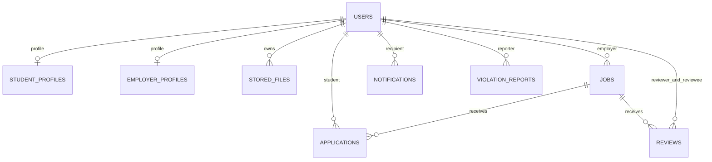

# Dữ liệu triển khai

H2 dev/test tạo schema từ JPA; MySQL được chuẩn bị bằng `db/mysql/schema.sql`, chưa kết nối thực tế. CV/ảnh nằm trên filesystem riêng, chỉ metadata nằm trong DB.

- `users`: email/SĐT UNIQUE, BCrypt hash, role/status, `contact_changed_at` giới hạn48h, `token_version` thu hồi token sau đổi mật khẩu.
- Hai bảng profile dùng PK đồng thời FK `user_id`.
- `stored_files`: UUID/ref, chủ sở hữu, tên gốc, MIME, kích thước, tên lưu duy nhất, thời điểm. Profile trỏ CV hiện tại; application giữ ref của snapshot khi nộp. Thay CV không xóa file của đơn cũ.
- `applications`: UNIQUE(job_id,student_id), PENDING→APPROVED/REJECTED; row lock/transaction bảo vệ cạnh tranh.
- `reviews`: UNIQUE(job_id,reviewer_id,reviewee_id), rating1–5. Vì một sinh viên chỉ có một application/job, ràng buộc này tương đương một đánh giá/đơn/mỗi chiều.
- `notifications`: UNREAD→READ, `related_type/related_id` là tham chiếu nghiệp vụ đa hình; recipient từ quyết định backend.
- `violation_reports` giữ tương thích source; luồng gửi/xử lý báo cáo đầy đủ ngoài phạm vi nghiệm thu7UC.

Không suy luận rằng SQL đã PASS MySQL từ việc H2 PASS. Đối chiếu kiểu ENUM, BOOLEAN/TINYINT, DECIMAL, ngày giờ và encoding khi người dùng cấu hình MySQL.
