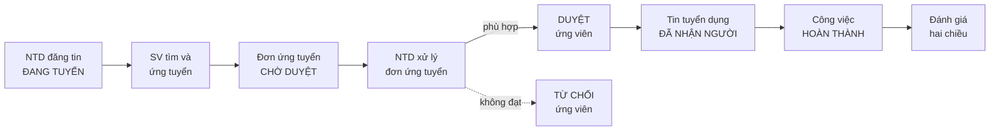
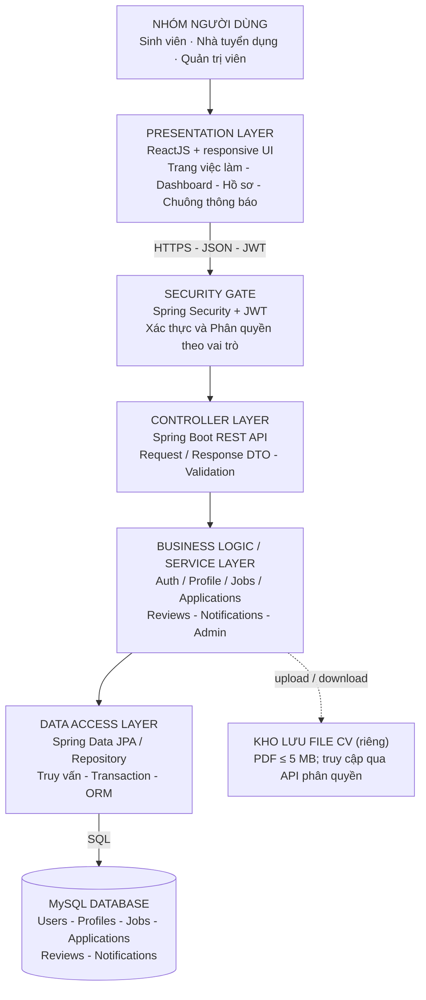

# CHUYÊN ĐỀ TỐT NGHIỆP 2 – NHÓM 07: TỔNG HỢP TÀI LIỆU

> Gộp từ 10 file: SRS, Báo cáo (Chương 1), Kế hoạch (xlsx, 4 sheet), API Contract, Nhật ký thực hiện, Mẫu báo cáo, 2 sơ đồ (drawio/png).
> Đề tài: **Nền tảng quản lý freelance / marketplace việc làm part-time cho sinh viên** – Trường ĐH Văn Lang, Khoa CNTT, chuyên ngành Công nghệ phần mềm.

## Mục lục

1. [Thông tin nhóm](#1-thông-tin-nhóm)
2. [SRS rút gọn](#2-srs-rút-gọn)
3. [Sơ đồ luồng nghiệp vụ](#3-sơ-đồ-luồng-nghiệp-vụ)
4. [Sơ đồ kiến trúc](#4-sơ-đồ-kiến-trúc)
5. [Actor và Use case](#5-actor-và-use-case)
6. [Product Backlog](#6-product-backlog)
7. [API Contract](#7-api-contract)
8. [Kế hoạch triển khai (Sprint)](#8-kế-hoạch-triển-khai-sprint)
9. [Báo cáo – Chương 1: Tổng quan](#9-báo-cáo--chương-1-tổng-quan)
10. [Nhật ký thực hiện (mẫu)](#10-nhật-ký-thực-hiện-mẫu)
11. [Mẫu báo cáo CDTN2 (quy định của khoa)](#11-mẫu-báo-cáo-cdtn2-quy-định-của-khoa)
12. [Điểm không khớp giữa các file](#12-điểm-không-khớp-giữa-các-file)

---

## 1. Thông tin nhóm

| Vai trò | Họ và tên | MSSV |
| --- | --- | --- |
| TV1 | Võ Nguyễn Thành Nhân | 2374802010360 |
| TV2 | Trường Luân | 2374802010296 |
| TV3 | Trần Văn Lễ | 2374802010270 |

- Giảng viên hướng dẫn (theo lời cảm ơn trong báo cáo): thầy Nguyễn Văn Trung
- Thời lượng: 10 buổi / 5 sprint

---

## 2. SRS rút gọn

### 2.1. Mô tả bài toán và mục tiêu sản phẩm

Sinh viên tìm việc làm thêm và nhà tuyển dụng cần nhân sự ngắn hạn hiện kết nối chủ yếu qua mạng xã hội, thông tin thiếu minh bạch, khó quản lý và không có đánh giá uy tín sau công việc.

**Mục tiêu:** xây dựng nền tảng web hai chiều (two-sided marketplace) cho phép Nhà tuyển dụng đăng tin, Sinh viên tìm kiếm và ứng tuyển, theo dõi trạng thái công việc và đánh giá hai chiều sau khi hoàn thành.

**Luồng nghiệp vụ chính:** đăng tin → ứng tuyển → duyệt → hoàn thành → đánh giá.

### 2.2. Người dùng (Actor)

| Mã | Actor | Mô tả |
| --- | --- | --- |
| ACT_01 | Sinh viên | Người tìm việc part-time: đăng ký/đăng nhập, cập nhật hồ sơ (CV, ảnh đại diện, giới thiệu bản thân), tìm kiếm và lọc tin, ứng tuyển, theo dõi trạng thái ứng tuyển, đánh giá Nhà tuyển dụng. |
| ACT_02 | Quản trị viên | Người quản lý hệ thống: quản lý tài khoản Sinh viên/Nhà tuyển dụng, kiểm duyệt tin tuyển dụng, xử lý báo cáo vi phạm. |
| ACT_03 | Nhà tuyển dụng | Doanh nghiệp/cá nhân cần thuê nhân sự ngắn hạn: cập nhật hồ sơ công ty, đăng và quản lý tin, duyệt/từ chối ứng viên, cập nhật trạng thái công việc, đánh giá Sinh viên. |

### 2.3. Yêu cầu chức năng

| Mã | Yêu cầu | Actor | Nguồn |
| --- | --- | --- | --- |
| FR-01 | Đăng ký tài khoản (Họ tên, SĐT, Email, mật khẩu, vai trò) | Sinh viên, Nhà tuyển dụng | PB-01.1 |
| FR-02 | Đăng nhập bằng email/SĐT và mật khẩu, điều hướng theo vai trò | Cả 3 actor | PB-01.2 |
| FR-03 | Quản lý hồ sơ: Sinh viên (CV PDF, ảnh, giới thiệu), Nhà tuyển dụng (tên, địa chỉ, mô tả công ty), đổi thông tin tài khoản, đăng xuất | Sinh viên, Nhà tuyển dụng | PB-01.3 |
| FR-04 | Đăng tin tuyển dụng part-time; mặc định trạng thái "Đang tuyển" | Nhà tuyển dụng | PB-02.1 |
| FR-05 | Cập nhật trạng thái tin: Đang tuyển → Đã nhận người → Hoàn thành; tự khóa ứng tuyển khi không còn "Đang tuyển" | Nhà tuyển dụng | PB-02.2 |
| FR-06 | Tìm kiếm theo từ khóa; lọc theo ngành nghề, địa điểm, thời gian, mức lương; phân trang | Sinh viên | PB-03.1 |
| FR-07 | Ứng tuyển kèm CV và thư giới thiệu vào tin đang tuyển | Sinh viên | PB-03.2 |
| FR-08 | Xem danh sách ứng viên của từng tin và hồ sơ chi tiết | Nhà tuyển dụng | PB-04.1 |
| FR-09 | Duyệt hoặc từ chối ứng viên; lưu trạng thái và gửi thông báo | Nhà tuyển dụng | PB-04.2 |
| FR-10 | Đánh giá Nhà tuyển dụng (bình luận, rating) sau khi hoàn thành, 1 lần/công việc | Sinh viên | PB-05.1 |
| FR-11 | Đánh giá Sinh viên đã được duyệt/hoàn thành; hiển thị công khai trên hồ sơ | Nhà tuyển dụng | PB-05.2 |
| FR-12 | Thông báo trạng thái ứng tuyển qua chuông thông báo; thông báo chưa đọc in đậm | Sinh viên | PB-06.1 |
| FR-13 | Quản lý tài khoản người dùng (xem, khóa/mở khóa, xóa) | Quản trị viên | PB-07.2 |
| FR-14 | Kiểm duyệt, gỡ tin tuyển dụng vi phạm | Quản trị viên | PB-07.3 |
| FR-15 | Xử lý báo cáo vi phạm từ người dùng | Quản trị viên | PB-07.4 |

### 2.4. Yêu cầu phi chức năng

| Mã | Yêu cầu (đo lường được) | Nguồn |
| --- | --- | --- |
| NFR-01 | Bảo mật mật khẩu: tối thiểu 8 ký tự gồm chữ hoa, chữ thường, ký tự đặc biệt; lưu dưới dạng đã mã hóa | AC-1.1.2 (phần mã hóa: đề xuất) |
| NFR-02 | Phân quyền: mọi API kiểm tra JWT và vai trò; truy cập sai vai trò bị từ chối | Đề xuất |
| NFR-03 | Tệp CV chỉ nhận định dạng PDF, tối đa 5MB | AC-1.3.1 |
| NFR-04 | Hiệu năng: trang danh sách việc làm tải trong tối đa 3 giây, hiển thị tối đa 12 tin/trang | AC-3.1.3 (mốc 3 giây: đề xuất) |
| NFR-05 | Giao diện responsive, hiển thị đúng trên màn hình từ 360px trở lên | Đề xuất |

---

## 3. Sơ đồ luồng nghiệp vụ

*(Từ `LuongNghiepVu.drawio` / `LuongNghiepVu.png`)*



---

## 4. Sơ đồ kiến trúc

*(Từ `SoDoKienTruc.drawio` / `SoDoKienTruc.png`)*



| Tầng | Công nghệ / Vai trò |
| --- | --- |
| Presentation | ReactJS, responsive UI: trang việc làm, dashboard, hồ sơ, chuông thông báo |
| Security Gate | Spring Security + JWT: xác thực, phân quyền theo vai trò |
| Controller | Spring Boot REST API, DTO, validation |
| Service | Auth, Profile, Jobs, Applications, Reviews, Notifications, Admin |
| Data Access | Spring Data JPA / Repository, transaction, ORM |
| Database | MySQL: Users, Profiles, Jobs, Applications, Reviews, Notifications |
| File storage | Kho lưu CV riêng, PDF ≤ 5 MB, truy cập qua API có phân quyền |

---

## 5. Actor và Use case

### 5.1. Bảng Actor (sheet *Actor*)

| Actor ID | Actor | Loại | Mô tả |
| --- | --- | --- | --- |
| ACT_01 | Sinh viên | Primary | Người tìm việc: đăng ký/đăng nhập, cập nhật hồ sơ (CV, ảnh đại diện, giới thiệu bản thân), tìm kiếm và lọc tin, ứng tuyển part-time, theo dõi trạng thái ứng tuyển, đánh giá Nhà tuyển dụng sau khi hoàn thành. |
| ACT_02 | Quản trị viên | Secondary | Quản lý toàn bộ hệ thống: quản lý tài khoản Sinh viên/Nhà tuyển dụng, kiểm duyệt tin, xử lý báo cáo vi phạm, theo dõi hoạt động chung. |
| ACT_03 | Nhà tuyển dụng | Primary | Tìm nhân sự: đăng ký/đăng nhập, cập nhật hồ sơ doanh nghiệp, đăng tin part-time, quản lý ứng viên (duyệt/từ chối), cập nhật trạng thái công việc, đánh giá Sinh viên. |

### 5.2. Bảng Use case (sheet *Usecase*)

**Dùng chung**

| UC ID | Use case | Primary Actor | Secondary Actor | Ưu tiên | Mô tả |
| --- | --- | --- | --- | --- | --- |
| UC_01 | Đăng nhập | Sinh viên, Nhà tuyển dụng, Quản trị viên | Không có | High | Đăng nhập bằng email hoặc SĐT và mật khẩu, điều hướng theo vai trò |

**Sinh viên**

| UC ID | Use case | Secondary Actor | Ưu tiên | Mô tả |
| --- | --- | --- | --- | --- |
| UC_02 | Đăng ký tài khoản | Không có | High | Điền họ tên, email, SĐT, mật khẩu để tạo tài khoản Sinh viên |
| UC_03 | Cập nhật hồ sơ cá nhân | Không có | High | Upload CV, ảnh đại diện, giới thiệu bản thân, SĐT, email, mật khẩu |
| UC_04 | Tìm kiếm và lọc việc làm | Không có | High | Tìm theo từ khóa; lọc theo ngành nghề, địa điểm, thời gian làm việc, mức lương |
| UC_05 | Ứng tuyển việc làm | Nhà tuyển dụng | High | Nộp hồ sơ vào tin "Đang tuyển" bằng cách chọn/upload CV và điền thông tin liên hệ |
| UC_06 | Đánh giá Nhà tuyển dụng | Nhà tuyển dụng | Medium | Bình luận và rating sau khi hoàn thành, mỗi công việc 1 lần |
| UC_07 | Nhận thông báo | Không có | Medium | Nhận thông báo khi Nhà tuyển dụng Duyệt/Từ chối hồ sơ |

**Quản trị viên**

| UC ID | Use case | Secondary Actor | Ưu tiên | Mô tả |
| --- | --- | --- | --- | --- |
| UC_08 | Quản lý tài khoản người dùng | Sinh viên, Nhà tuyển dụng | High | Xem danh sách, khóa/mở khóa hoặc xóa tài khoản vi phạm |
| UC_09 | Kiểm duyệt tin tuyển dụng | Nhà tuyển dụng | High | Xem, duyệt hoặc gỡ tin vi phạm, spam hoặc không phù hợp |
| UC_10 | Xử lý báo cáo vi phạm | Sinh viên, Nhà tuyển dụng | Medium | Tiếp nhận và xử lý báo cáo (tài khoản giả mạo, tin lừa đảo...), quyết định cảnh cáo/khóa tài khoản |

**Nhà tuyển dụng**

| UC ID | Use case | Secondary Actor | Ưu tiên | Mô tả |
| --- | --- | --- | --- | --- |
| UC_NTD_01 | Quản lý hồ sơ Nhà tuyển dụng | Dịch vụ lưu trữ đám mây | Medium | Cập nhật tên, logo, địa chỉ, SĐT, mô tả ngắn |
| UC_NTD_02 | Đăng tin tuyển dụng (Create Job) | Không có | Medium | Điền tiêu đề, mô tả, yêu cầu kỹ năng, mức lương, thời gian và địa điểm |
| UC_NTD_03 | Quản lý tin tuyển dụng (Manage Jobs) | Không có | High | Xem danh sách tin đã đăng; sửa (nếu chưa có ai ứng tuyển), ẩn hoặc đóng tin khi đủ người |
| UC_NTD_04 | Quản lý danh sách ứng viên (Manage Applications) | Không có | High | Xem danh sách ứng viên, click xem chi tiết CV/hồ sơ |
| UC_NTD_05 | Phê duyệt / Từ chối ứng viên | Hệ thống gửi mail | High | Đổi trạng thái thành "Chấp nhận" hoặc "Từ chối" |
| UC_NTD_06 | Cập nhật trạng thái công việc (Update Job Status) | Không có | Medium | Chuyển Open → In Progress → Completed |
| UC_NTD_07 | Đánh giá Sinh viên (Rate Student) | Không có | Medium | Chấm 1–5 sao và nhận xét thái độ, hiệu suất khi công việc hoàn thành |

---

## 6. Product Backlog

Ký hiệu: **Sprint** và **MoSCoW** tính theo từng PB; **Ưu tiên** theo từng AC.

### PB-01 – Quản lý Tài khoản & Phân quyền

**PB-01.1 – Đăng ký tài khoản** · Sprint 2 · MUST
*Là Sinh viên/Nhà tuyển dụng, tôi muốn đăng ký tài khoản với vai trò tương ứng để sử dụng nền tảng.*

| AC | Tiêu chí chấp nhận | Ưu tiên |
| --- | --- | --- |
| AC-1.1.1 | Form đăng ký có các trường bắt buộc: Họ tên, SĐT, Email, mật khẩu, Vai trò | High |
| AC-1.1.2 | Email đúng định dạng; mật khẩu tối thiểu 8 ký tự gồm chữ hoa, chữ thường, ký tự đặc biệt | Medium |
| AC-1.1.3 | Email đã tồn tại → chữ đỏ "Email này đã được đăng kí" | Medium |
| AC-1.1.4 | Thông tin hợp lệ và bấm đăng ký → thông báo "Đăng kí thành công" | High |

**PB-01.2 – Đăng nhập tài khoản** · Sprint 2 · MUST
*Là Sinh viên/Nhà tuyển dụng/Quản trị viên, tôi muốn đăng nhập để dùng chức năng theo vai trò.*

| AC | Tiêu chí chấp nhận | Ưu tiên |
| --- | --- | --- |
| AC-1.2.1 | Đăng nhập bằng email hoặc SĐT và mật khẩu; điều hướng theo vai trò | High |
| AC-1.2.2 | Sai tên đăng nhập/mật khẩu → chữ đỏ "Tên đăng nhập hoặc mật khẩu chưa đúng" | Medium |

**PB-01.3 – Hồ sơ cá nhân** · Sprint 2 · MUST
*Là Sinh viên/Nhà tuyển dụng, tôi muốn cập nhật hồ sơ để người khác xem thông tin của tôi.*

| AC | Tiêu chí chấp nhận | Ưu tiên |
| --- | --- | --- |
| AC-1.3.1 | Sinh viên upload CV (PDF, tối đa 5MB), đổi ảnh đại diện, điền "Giới thiệu bản thân" | High |
| AC-1.3.2 | Nhà tuyển dụng cập nhật tên/tổ chức, SĐT, địa chỉ, mô tả công ty | Medium |
| AC-1.3.3 | Thay đổi SĐT, email, mật khẩu; giới hạn thay đổi sau 48 giờ | Medium |
| AC-1.3.4 | Cho phép đăng xuất và đổi tài khoản | Low |

### PB-02 – Quản lý tin tuyển dụng

**PB-02.1 – Đăng tin việc làm** · Sprint 3 · MUST
*Là Nhà tuyển dụng, tôi muốn tạo và đăng tin để tìm sinh viên.*

| AC | Tiêu chí chấp nhận | Ưu tiên |
| --- | --- | --- |
| AC-2.1.1 | Form bắt buộc: Tên công việc, Ngành nghề, Mô tả, Yêu cầu ứng viên, Quyền lợi, Mức lương, Địa điểm và thời gian làm việc, Thời hạn ứng tuyển | High |
| AC-2.1.3 | Tạo xong → "Đăng tin thành công", mặc định "Đang tuyển", xuất hiện ngay trên trang tìm kiếm chung | High |

**PB-02.2 – Quản lý trạng thái tin tuyển dụng** · MUST
*Là Nhà tuyển dụng, tôi muốn cập nhật trạng thái tin để quản lý tiến độ.*

| AC | Tiêu chí chấp nhận | Ưu tiên |
| --- | --- | --- |
| AC-2.2.1 | Chuyển qua 3 trạng thái: "Đang tuyển", "Đã nhận người", "Hoàn thành" | High |
| AC-2.2.2 | "Đã nhận người" và "Hoàn thành" → tự khóa chức năng ứng tuyển | High |

### PB-03 – Tìm kiếm & Ứng tuyển

**PB-03.1 – Tìm kiếm và lọc việc làm** · Sprint 3 · MUST
*Là Sinh viên, tôi muốn tìm và lọc tin đang tuyển để chọn việc phù hợp.*

| AC | Tiêu chí chấp nhận | Ưu tiên |
| --- | --- | --- |
| AC-3.1.1 | Thanh tìm kiếm theo từ khóa (tên, mô tả, ngành nghề), trả kết quả khớp | High |
| AC-3.1.2 | Bộ lọc theo ngành nghề, địa điểm, thời gian làm việc, mức lương | High |
| AC-3.1.3 | Phân trang, tối đa 12 tin/trang | Medium |
| AC-3.1.4 | Danh sách hiển thị: Tên công việc, tên doanh nghiệp, mức lương, Thành phố | High |

**PB-03.2 – Ứng tuyển việc làm** · Sprint 3 · MUST
*Là Sinh viên, tôi muốn ứng tuyển vào công việc phù hợp.*

| AC | Tiêu chí chấp nhận | Ưu tiên |
| --- | --- | --- |
| AC-3.2.1 | Nút "Ứng tuyển ngay" xuất hiện trong tin có trạng thái "Đang tuyển" | High |
| AC-3.2.2 | Form ứng tuyển: chọn/upload CV, Họ tên, email, SĐT, Thư giới thiệu | High |
| AC-3.2.3 | Checkbox cho phép Nhà tuyển dụng sử dụng dữ liệu cá nhân của sinh viên | Medium |
| AC-3.2.4 | Nộp xong → "Nộp hồ sơ Ứng tuyển thành công" | Medium |

### PB-04 – Quản lý Ứng viên

**PB-04.1 – Xem danh sách ứng viên** · Sprint 4 · MUST
*Là Nhà tuyển dụng, tôi muốn xem tất cả sinh viên đã nộp hồ sơ vào tin của mình.*

| AC | Tiêu chí chấp nhận | Ưu tiên |
| --- | --- | --- |
| AC-4.1.1 | Trong chi tiết bài đăng thấy: Tên, Thời gian nộp, file CV, Thư giới thiệu, trạng thái hiện tại (Chờ duyệt) | High |
| AC-4.1.2 | Click tên sinh viên để xem hồ sơ cá nhân | High |

**PB-04.2 – Duyệt trạng thái ứng viên**
*Là Nhà tuyển dụng, tôi muốn cập nhật trạng thái ứng viên để chốt ứng viên.*

| AC | Tiêu chí chấp nhận | Ưu tiên |
| --- | --- | --- |
| AC-4.2.1 | "Duyệt"/"Từ chối" → hệ thống lưu trạng thái và gửi thông báo đến ứng viên | Medium |

### PB-05 – Đánh giá và Phản hồi hai chiều

**PB-05.1 – Đánh giá Nhà tuyển dụng** · Sprint 4 · SHOULD
*Là Sinh viên đã hoàn thành công việc, tôi muốn đánh giá Nhà tuyển dụng để cảnh báo hoặc đề xuất cho người khác.*

| AC | Tiêu chí chấp nhận | Ưu tiên |
| --- | --- | --- |
| AC-5.1.1 | Chỉ mở khóa với ứng viên ở trạng thái "Hoàn thành" | High |
| AC-5.1.2 | Form gồm: Text bình luận, Rating | Medium |
| AC-5.1.3 | Mỗi ứng viên chỉ đánh giá 1 lần cho 1 công việc | Low |

**PB-05.2 – Đánh giá Sinh viên** · SHOULD
*Là Nhà tuyển dụng, tôi muốn đánh giá sinh viên đã hoàn thành để ghi nhận chất lượng.*

| AC | Tiêu chí chấp nhận | Ưu tiên |
| --- | --- | --- |
| AC-5.2.1 | Đánh giá được các ứng viên "Duyệt" và "Hoàn thành" | High |
| AC-5.2.2 | Đánh giá hiển thị công khai trên profile của Nhà tuyển dụng và Sinh viên | Medium |

### PB-06 – Hệ thống thông báo

**PB-06.1 – Thông báo trạng thái ứng tuyển** · Sprint 4 · SHOULD
*Là Sinh viên, tôi muốn nhận thông báo trên web hoặc email khi hồ sơ được cập nhật.*

| AC | Tiêu chí chấp nhận | Ưu tiên |
| --- | --- | --- |
| AC-6.1.1 | Hiển thị thông báo trong chuông thông báo | High |
| AC-6.1.2 | Thông báo chưa đọc in đậm | Medium |

### PB-07 – Quản trị hệ thống

**PB-07.1 – Xem danh sách thống kê** · Sprint 4 · SHOULD
*Là Quản trị viên, tôi muốn xem số liệu tổng quan hoạt động.*

| AC | Tiêu chí chấp nhận | Ưu tiên |
| --- | --- | --- |
| AC-7.1.1 | Bảng số liệu: tổng số sinh viên, nhà tuyển dụng, việc làm, ứng tuyển | High |
| AC-7.1.2 | Từng mục bấm vào xem danh sách chi tiết | Medium |

**PB-07.2 – Quản lý tin tuyển dụng** · SHOULD
*Là Quản trị viên, tôi muốn quản lý tin để xử lý dấu hiệu bất thường.*

| AC | Tiêu chí chấp nhận | Ưu tiên |
| --- | --- | --- |
| AC-7.2.1 | Cập nhật, gỡ tin; tin bị xóa biến mất khỏi trang tìm việc của sinh viên | High |
| AC-7.2.2 | Tìm kiếm, lọc theo tên, vai trò, ngành nghề, địa chỉ nhà tuyển dụng | Medium |
| AC-7.2.3 | Phân trang tối đa 12 tin/trang | Medium |
| AC-7.2.4 | Xem tất cả tin và click xem chi tiết | High |
| AC-7.2.5 | Gỡ tin phải nhập "Lý do vi phạm"; sau khi gỡ gửi thông báo kèm lý do cho Nhà tuyển dụng | High |

**PB-07.3 – Quản lý người dùng** · SHOULD
*Là Quản trị viên, tôi muốn quản lý toàn bộ tài khoản để xử lý tài khoản bất thường.*

| AC | Tiêu chí chấp nhận | Ưu tiên |
| --- | --- | --- |
| AC-7.3.1 | Xem, lọc theo vai trò, trạng thái hoạt động; tìm theo tên, email | High |
| AC-7.3.2 | Click hồ sơ bất kỳ xem chi tiết, gồm lịch sử đăng tin/ứng tuyển | High |
| AC-7.3.3 | Khóa tài khoản kèm thông báo lý do | High |
| AC-7.3.4 | Tài khoản bị khóa bị log out mọi thiết bị, không thể đăng nhập | High |

**PB-07.4 – Quản lý đánh giá** · COULD
*Là Quản trị viên, tôi muốn quản lý đánh giá để bảo vệ người dùng khỏi tấn công ngôn từ.*

| AC | Tiêu chí chấp nhận | Ưu tiên |
| --- | --- | --- |
| AC-7.4.1 | Xem danh sách đánh giá: bảng tin, người đánh giá, người bị đánh giá, nội dung, thời gian | High |
| AC-7.4.2 | Ẩn đánh giá không phù hợp hoặc spam | High |
| AC-7.4.3 | Khóa quyền đánh giá của tài khoản bất kỳ, yêu cầu "lý do vi phạm", gửi thông báo cho tài khoản bị khóa | High |

---

## 7. API Contract

> Thiết kế đề xuất, **chưa đối chiếu Controller thực tế**.

| Method | Endpoint | Quyền | FR | Mô tả & HTTP |
| --- | --- | --- | --- | --- |
| POST | `/api/auth/register` | Public | FR-01 | Tạo STUDENT/EMPLOYER; 201 / 400 / 409 |
| POST | `/api/auth/login` | Public | FR-02 | Xác thực; trả accessToken và role; 200 / 401 |
| GET | `/api/me/profile` | Auth | FR-03 | Hồ sơ theo vai trò; 200 / 401 |
| PUT | `/api/me/profile` | Auth | FR-03 | Cập nhật hồ sơ; 200 / 400 |
| POST | `/api/me/cv` | STUDENT | FR-03 | Upload PDF ≤5MB; 201 / 413 / 415 |
| GET | `/api/jobs` | Public | FR-06 | Filter keyword, category, location, minSalary, maxSalary, page, size; 200 |
| GET | `/api/jobs/{id}` | Public | FR-06 | Chi tiết tin đang công khai; 200 / 404 |
| POST | `/api/jobs` | EMPLOYER | FR-04 | Tạo tin, trạng thái OPEN; 201 / 400 / 403 |
| PUT | `/api/jobs/{id}` | EMPLOYER (owner) | FR-04 | Cập nhật tin đúng chủ sở hữu; 200 / 403 |
| PATCH | `/api/jobs/{id}/status` | EMPLOYER (owner) | FR-05 | OPEN→FILLED→COMPLETED; 200 / 409 |
| POST | `/api/jobs/{id}/applications` | STUDENT | FR-07 | Nộp CV, coverLetter, consent; 201 / 409 |
| GET | `/api/jobs/{id}/applications` | EMPLOYER (owner) | FR-08 | Danh sách đơn theo tin; 200 / 403 |
| PATCH | `/api/applications/{id}/decision` | EMPLOYER (owner) | FR-09 | APPROVED/REJECTED; tạo notification; 200 / 409 |
| POST | `/api/applications/{id}/reviews` | STUDENT/EMPLOYER | FR-10/11 | Đánh giá hai chiều; 201 / 403 / 409 |
| GET | `/api/me/notifications` | Auth | FR-12 | Danh sách và số chưa đọc; 200 |
| PATCH | `/api/me/notifications/{id}/read` | Auth (owner) | FR-12 | Đánh dấu đã đọc; 200 / 403 |
| GET | `/api/admin/users` | ADMIN | FR-13 | Danh sách người dùng; 200 / 403 |
| PATCH | `/api/admin/users/{id}/status` | ADMIN | FR-13 | Khóa/mở khóa tài khoản; 200 / 403 |
| PATCH | `/api/admin/jobs/{id}/moderation` | ADMIN | FR-14 | Gỡ/khôi phục tin vi phạm; 200 / 403 |
| POST | `/api/reports` | Auth | FR-15 | Gửi báo cáo vi phạm; 201 / 400 |
| GET | `/api/admin/reports` | ADMIN | FR-15 | Xem danh sách vi phạm; 200 / 403 |
| PATCH | `/api/admin/reports/{id}` | ADMIN | FR-15 | Giải quyết báo cáo; 200 / 409 |

### 7.1. Ví dụ hợp đồng request/response

**POST `/api/jobs`** — `Authorization: Bearer <JWT>` — `Content-Type: application/json` (EMPLOYER)

Request:

```json
{
  "title": "Thiết kế giao diện web",
  "category": "IT",
  "description": "Thiết kế trang web giới thiệu",
  "salaryMin": 60000,
  "salaryMax": 100000,
  "location": "TP.HCM",
  "workSchedule": "Linh hoạt",
  "deadline": "2026-11-30"
}
```

Response 201:

```json
{ "jobId": 101, "status": "OPEN", "message": "Tạo tin thành công" }
```

**PATCH `/api/applications/501/decision`**

Request: `{ "decision": "APPROVED" }`

Response 200:

```json
{ "applicationId": 501, "status": "APPROVED", "notificationCreated": true }
```

### 7.2. Quy ước lỗi

| Mã | Ý nghĩa |
| --- | --- |
| 400 | Sai dữ liệu |
| 401 | Chưa/không xác thực |
| 403 | Sai role / không sở hữu |
| 404 | Không tìm thấy |
| 409 | Xung đột trạng thái hoặc nộp trùng |
| 413 | File quá lớn |
| 415 | Sai định dạng |

Body lỗi:

```json
{ "code": "JOB_NOT_OPEN", "message": "Tin không còn nhận hồ sơ" }
```

---

## 8. Kế hoạch triển khai (Sprint)

*(Sheet "1. Kế hoạch triển khai". Ngày giữ nguyên như file gốc, xem mục 12 về các ngày bị sai.)*

### Sprint 0

| Task | Việc cần làm | Giao cho | Dự kiến (bắt đầu → kết thúc, giờ) | Thực tế (bắt đầu → kết thúc, giờ) | Tiêu chí hoàn thành | Trạng thái |
| --- | --- | --- | --- | --- | --- | --- |
| S-0.1 | Phân tích yêu cầu đề tài | Văn Lễ, Trường Luân | 21/9/2026 → 26/9/2026 (2h) | 24/9/2026 → 27/9/2027 (2h) | Hoàn thành Chương 1 TỔNG QUAN: bảng thông tin SV/GV, lời cảm ơn, giới thiệu, mục tiêu, phạm vi, công nghệ | Done |
| S-0.2 | Xác định Actor / Usecase | Trường Luân, Văn Lễ | 21/9/2027 → 26/9/2027 (3h) | 24/9/2027 → 27/9/2027 (3h) | Lập bảng Actor, bảng Usecase | Done |
| S-0.3 | Lập Product backlog | Thành Nhân | 21/9/2028 → 26/9/2028 (4h) | 24/9/2028 → 25/9/2026 (5h) | Lập Product backlog | Done |
| S-0.4 | Lập kế hoạch sprint 1 | Thành Nhân | 21/9/2029 → 26/9/2029 (0.5h) | 24/9/2029 → 24/9/2030 (0.5h) | Kế hoạch sprint 1 | Done |
| S-0.5 | Set up môi trường, phần mềm | Thành Nhân, Văn Lễ, Trường Luân | 21/9/2030 → 26/9/2030 (0.5h) | 27/9/2027 → 27/9/2027 (0.5h) | Cài GitHub, Postman, IntelliJ IDEA, MySQL Workbench; tạo folder làm việc nhóm; tạo project folder GitHub | Done |
| S-0.6 | Review Sprint 0 | Thành Nhân, Văn Lễ, Trường Luân | 27/9/2026 → 27/9/2027 (0.5h) | 27/9/2026 → 27/9/2027 (0.5h) | Rà soát lại nội dung đã thực hiện | Done |
| S-07 | Thêm sprint, Priority, rà soát yêu cầu chức năng product backlog | – | – | – | – | – |
| S-08 | Thực hiện file SRS rút gọn | – | – | – | – | – |

### Sprint 1

| Task | Việc cần làm | Giao cho | Dự kiến (bắt đầu → kết thúc, giờ) | Thực tế (bắt đầu → kết thúc, giờ) | Tiêu chí hoàn thành | Trạng thái |
| --- | --- | --- | --- | --- | --- | --- |
| S-1.1 | Thực hiện bản đặc tả yêu cầu (SRS rút gọn) | Văn Lễ | 28/9/2026 → 29/9/2026 (5h) | 28/9/2026 → 29/9/2026 (5h) | Hoàn thành file đặc tả yêu cầu | Done |
| S-1.2 | Rà soát danh sách yêu cầu chức năng trong phạm vi 10 buổi | Cả nhóm | 29/9/2026 → `46063` (2h) | 29/9/2026 → `46063` (2h) | Lược bỏ chức năng/yêu cầu ngoài phạm vi 10 buổi | Done |
| S-1.3 | Lên kế hoạch Agile/Scrum cho buổi 3 | Cả nhóm | `46091` → `46091` (2h) | `46091` → `46091` (2h) | Kế hoạch thực hiện nội dung buổi 3 | Done |
| S-1.4 | Cập nhật nhật ký thực hiện đề tài buổi 2 | Thành Nhân | `46091` → `46091` (1h) | `46091` → `46091` (1h) | Báo cáo tiến độ công việc buổi 2 | Done |

### Sprint 2 (cập nhật mới)

Tổng ước lượng: **49h**. Chưa có ngày bắt đầu/kết thúc, thực tế và trạng thái.

| Task | Việc cần làm | Giao cho | Ước lượng (giờ) | Tiêu chí hoàn thành | Use case |
| --- | --- | --- | --- | --- | --- |
| S2-01 | Xây đăng nhập JWT, phân quyền 3 vai trò, giao diện login | Thành Nhân | 9 | API login; invalid credentials; redirect role; test 200/401 | UC_01 |
| S2-02 | Xây đăng ký sinh viên/NTD, validate và chống trùng email | Thành Nhân | 8 | API và form đăng ký; email trùng, regex mật khẩu, toast; tests | UC_02 |
| S2-03 | Hồ sơ sinh viên: thông tin, ảnh, CV PDF ≤5MB | Thành Nhân | 11 | Trang sửa hồ sơ, backend validation file, test quyền sở hữu | UC_03 |
| S2-04 | Thống nhất cấu trúc Job/Application, API contract và DTO | Trần Văn Lễ | 7 | Migrations/entity/DTO/schema; ví dụ request/response thống nhất; PR review | UC_NTD_02 / UC_NTD_04 |
| S2-05 | Tạo tin tuyển dụng (backend + form NTD) | Trần Văn Lễ | 10 | POST tạo tin, validate trường, mặc định Đang tuyển, UI; tests | UC_NTD_02 |
| S2-06 | Khung trang quản lý danh sách tin tuyển dụng cá nhân | Trần Văn Lễ | 4 | GET /employer/jobs chỉ trả tin thuộc NTD; UI liệt kê | UC_NTD_03 |

### Sprint 3

Tổng ước lượng: **54h**.

| Task | Việc cần làm | Giao cho | Ước lượng (giờ) | Tiêu chí hoàn thành | Use case |
| --- | --- | --- | --- | --- | --- |
| S3-01 | API danh sách/tìm kiếm/lọc/phân trang tin đang tuyển | Trần Văn Lễ | 8 | GET /jobs, /jobs/{id}, query filters, 12/trang; API test | UC_04 |
| S3-02 | Giao diện tìm kiếm, bộ lọc, job card, phân trang | Thành Nhân | 8 | UI tìm/lọc/paging từ API thật, responsive; demo kết quả | UC_04 |
| S3-03 | NTD sửa tin khi chưa có hồ sơ, ẩn/đóng tin | Trần Văn Lễ | 10 | GET/PUT/PATCH theo quyền sở hữu, chỉ sửa khi chưa có hồ sơ; tests | UC_NTD_03 |
| S3-04 | NTD cập nhật 3 trạng thái và tự khóa ứng tuyển | Trần Văn Lễ | 7 | PATCH status; chặn nộp đơn nếu không còn Đang tuyển; tests | UC_NTD_06 |
| S3-05 | API nộp đơn kèm CV và thư giới thiệu | Trần Văn Lễ | 7 | POST applications; kiểm tra trạng thái tin + SV + CV + đồng ý dữ liệu | UC_05 |
| S3-06 | Form ứng tuyển dành cho SV và trạng thái phản hồi | Trường Luân | 8 | Chọn CV, thư giới thiệu, checkbox, thông báo thành công/lỗi | UC_05 |
| S3-07 | API danh sách ứng viên của từng tin tuyển dụng | Trần Văn Lễ | 6 | GET danh sách/chi tiết ứng viên đúng NTD; bảo vệ URL CV | UC_NTD_04 |

### Sprint 4

Tổng ước lượng: **60h**.

| Task | Việc cần làm | Giao cho | Ước lượng (giờ) | Tiêu chí hoàn thành | Use case |
| --- | --- | --- | --- | --- | --- |
| S4-01 | Giao diện NTD xem danh sách ứng viên, chi tiết CV | Trần Văn Lễ | 7 | Bảng ứng viên, trạng thái, mở CV qua API có quyền | UC_NTD_04 |
| S4-02 | Duyệt/từ chối ứng viên; phát sự kiện thông báo | Trần Văn Lễ | 8 | PATCH accept/reject, giữ audit và phát notification; test phân quyền | UC_NTD_05 |
| S4-03 | API thông báo + chuông thông báo cho sinh viên | Thành Nhân | 10 | GET thông báo; unread in đậm; đánh dấu đọc; nhận sự kiện duyệt/từ chối | UC_07 |
| S4-04 | Backend quản trị kiểm duyệt/gỡ tin kèm lý do | Trần Văn Lễ | 7 | Admin list/hide/post reason; NTD nhận thông báo; role ADMIN | UC_09 |
| S4-05 | Giao diện quản trị xem/gỡ tin (phối hợp UC_09) | Thành Nhân | 7 | UI lọc/xem chi tiết/gỡ tin/lý do; gọi API của Lễ | UC_09 (hỗ trợ) |
| S4-06 | Kiểm thử auth, CV, tìm kiếm, ứng tuyển, notification | Thành Nhân | 8 | Test case, ảnh kết quả; bao phủ lỗi 400/401/403 | UC_01/02/03/04/05/07 |
| S4-07 | Kiểm thử đăng tin, ứng viên, duyệt, trạng thái, admin | Trần Văn Lễ | 8 | Test case, ảnh kết quả; quyền sở hữu/403 | UC_NTD_02/03/04/05/06, UC_09 |
| S4-08 | Test tích hợp frontend 3 vai trò, xử lý lỗi hợp đồng API | Thành Nhân | 5 | Luồng login SV/NTD/Admin; lỗi API hiển thị hợp lý | UC_01/04/05/07, UC_09 |

### Sprint 5

Tổng ước lượng: **27h**.

| Task | Việc cần làm | Giao cho | Ước lượng (giờ) | Tiêu chí hoàn thành | Use case |
| --- | --- | --- | --- | --- | --- |
| S5-01 | End-to-end SV: đăng ký → tìm → nộp → nhận thông báo | Thành Nhân | 5 | Video/screenshot demo và checklist PASS/FAIL | UC_01/02/03/04/05/07 |
| S5-02 | End-to-end NTD/Admin: đăng → duyệt → hoàn thành → gỡ tin | Trần Văn Lễ | 5 | Video/screenshot demo, quyền bị từ chối, checklist PASS/FAIL | UC_NTD_02/03/04/05/06, UC_09 |
| S5-03 | README cài đặt/ảnh demo luồng Sinh viên, các API của Luân | Thành Nhân | 4 | Hướng dẫn chạy, endpoint, hình demo, hạn chế đã biết | UC_01/02/03/04/05/07 |
| S5-04 | README cài đặt/ảnh demo NTD/Admin, các API của Lễ | Trần Văn Lễ | 4 | Hướng dẫn chạy, endpoint, hình demo, hạn chế đã biết | UC_NTD_02/03/04/05/06, UC_09 |
| S5-05 | Sửa lỗi responsive/UX và các lỗi SV sau UAT | Thành Nhân | 4 | Không còn lỗi blocker UI ở màn 360px và usecase SV | UC_03/04/05/07 |
| S5-06 | Sửa lỗi access-control/công việc/ứng viên sau UAT | Trần Văn Lễ | 5 | Không còn blocker nghiệp vụ và phân quyền; regression PASS | UC_NTD_02/03/04/05/06, UC_09 |

> Trong file xlsx, các task S3, S4, S5 nằm liền dưới tiêu đề SPRINT 2 (chưa tách tiêu đề riêng). Mình tách theo tiền tố mã task.

---

## 9. Báo cáo – Chương 1: Tổng quan

*(Từ `BAOCAO_cdtn2-06_2374802010360_VoNguyenThanhNhan.docx`. Trang bìa ghi: Báo cáo Chuyên đề tốt nghiệp 2, chuyên ngành Công nghệ phần mềm, TP. Hồ Chí Minh – Năm 2025. Mục lục để trống.)*

### Lời cảm ơn

Nhóm chúng em xin gửi lời cảm ơn chân thành đến thầy Nguyễn Văn Trung, giảng viên hướng dẫn học phần Chuyên đề tốt nghiệp 2, đã tận tình hướng dẫn, góp ý và hỗ trợ nhóm trong suốt quá trình phân tích, thiết kế và xây dựng đề tài. Nhờ sự chỉ dẫn của thầy, nhóm đã có định hướng rõ ràng hơn về phạm vi, công nghệ và kế hoạch triển khai đồ án.

Nhóm cũng xin cảm ơn Khoa Công nghệ thông tin – Trường Đại học Văn Lang đã tạo điều kiện về môi trường học tập, tài liệu tham khảo và cơ sở hạ tầng để nhóm hoàn thành đề tài này. Trong quá trình thực hiện, do kiến thức và kinh nghiệm còn hạn chế nên báo cáo khó tránh khỏi thiếu sót, nhóm rất mong nhận được sự góp ý từ thầy để hoàn thiện hơn.

### CHƯƠNG 1: TỔNG QUAN

#### 1.1. Giới thiệu đề tài

Hiện nay, nhu cầu tìm kiếm việc làm bán thời gian (part-time) của sinh viên và nhu cầu thuê nhân sự ngắn hạn của các cá nhân, doanh nghiệp ngày càng tăng cao. Tuy nhiên, việc kết nối giữa hai bên hiện chủ yếu diễn ra qua các kênh phi chính thức như mạng xã hội, hội nhóm truyền miệng, dẫn đến thông tin thiếu minh bạch, khó quản lý và không có cơ chế đánh giá uy tín sau khi hoàn thành công việc.

Xuất phát từ thực tế trên, nhóm đề xuất xây dựng đề tài "Nền tảng quản lý freelance / marketplace việc làm part-time cho sinh viên" – một nền tảng web hai chiều (two-sided marketplace), đóng vai trò trung gian kết nối trực tiếp giữa Sinh viên và Nhà tuyển dụng. Nền tảng cho phép Nhà tuyển dụng đăng tin việc làm part-time, Sinh viên tìm kiếm và ứng tuyển, đồng thời hỗ trợ theo dõi trạng thái công việc và đánh giá hai chiều sau khi công việc hoàn thành, giúp tăng tính minh bạch và độ tin cậy cho cả hai phía.

#### 1.2. Mục tiêu đề tài

Xây dựng một nền tảng web hai chiều kết nối sinh viên tìm việc làm thêm với nhà tuyển dụng/cá nhân có nhu cầu thuê nhân sự ngắn hạn, cho phép đăng tin, tìm kiếm, ứng tuyển, quản lý trạng thái công việc và đánh giá sau khi hoàn thành. Cụ thể:

- Xây dựng hệ thống đăng ký/đăng nhập và phân quyền theo 3 vai trò: Sinh viên, Nhà tuyển dụng và Quản trị viên.
- Cho phép Nhà tuyển dụng đăng tin tuyển dụng part-time với đầy đủ thông tin mô tả, thời gian, mức lương, địa điểm.
- Cho phép Sinh viên tìm kiếm, lọc tin theo ngành nghề/địa điểm/mức lương và ứng tuyển kèm hồ sơ (CV/giới thiệu bản thân).
- Hỗ trợ Nhà tuyển dụng quản lý danh sách ứng viên, duyệt/từ chối hồ sơ ứng tuyển.
- Theo dõi trạng thái công việc theo vòng đời: Đang tuyển → Đã nhận người → Hoàn thành.
- Xây dựng cơ chế đánh giá hai chiều giữa Sinh viên và Nhà tuyển dụng sau khi công việc hoàn thành.
- Xây dựng hệ thống thông báo cơ bản khi có cập nhật trạng thái ứng tuyển.

#### 1.3. Phạm vi đề tài

Để đảm bảo tính khả thi trong thời gian thực hiện chuyên đề (10 buổi/5 sprint), nhóm xác định phạm vi như sau.

**Trong phạm vi:**

1. Đăng ký/đăng nhập, phân quyền 3 vai trò: Sinh viên, Nhà tuyển dụng, Quản trị viên.
2. Nhà tuyển dụng đăng tin việc làm part-time (mô tả, thời gian, mức lương, địa điểm).
3. Sinh viên tìm kiếm, lọc tin theo ngành nghề/địa điểm/mức lương, ứng tuyển kèm hồ sơ (CV/giới thiệu bản thân).
4. Nhà tuyển dụng xem danh sách ứng viên, duyệt/từ chối ứng tuyển.
5. Theo dõi trạng thái công việc (đang tuyển, đã nhận người, hoàn thành).
6. Đánh giá hai chiều sau khi công việc hoàn thành.
7. Thông báo cơ bản khi có cập nhật trạng thái ứng tuyển.

**Ngoài phạm vi (không bắt buộc):**

8. Thanh toán/giao dịch tiền thật qua cổng thanh toán.
9. Ứng dụng di động native riêng biệt (ưu tiên web responsive).
10. Chat real-time nâng cao giữa hai bên (có thể để hướng phát triển).

#### 1.4. Công nghệ sử dụng

| Hạng mục | Công nghệ |
| --- | --- |
| Backend | Spring Boot (REST API), Spring Security + JWT (xác thực, phân quyền 3 vai trò); phát triển trên IntelliJ IDEA |
| Frontend | ReactJS, giao diện responsive |
| Cơ sở dữ liệu | MySQL, thiết kế và quản lý lược đồ bằng MySQL Workbench |
| Công cụ hỗ trợ | Git/GitHub (quản lý mã nguồn, làm việc nhóm), Postman (kiểm thử API) |
| Hạ tầng triển khai | Hosting chạy trên GitHub Codespace |

---

## 10. Nhật ký thực hiện (mẫu)

*(Từ `Nhật_ký_thực_hiện.docx`, file mẫu chưa điền.)*

**Trường Đại học Văn Lang – Khoa Công nghệ thông tin**
**NHẬT KÝ THỰC HIỆN CHUYÊN ĐỀ TỐT NGHIỆP 2**

**Thông tin sinh viên**

| MSSV | Họ và tên | Chuyên ngành | Khoá |
| --- | --- | --- | --- |
|  |  |  |  |
|  |  |  |  |

- Giảng viên hướng dẫn (GVHD): ………
- Tên đề tài nghiên cứu: ………

**Nhật ký thực hiện và làm việc với GVHD**

| Tuần/Ngày | Đã thực hiện | Tiếp tục thực hiện |
| --- | --- | --- |
| Tuần 1 (từ ngày … đến ngày …) |  |  |
| Tuần 2 (từ ngày … đến ngày …) |  |  |
| Tuần 3 (từ ngày … đến ngày …) |  |  |
| Tuần 4 (từ ngày … đến ngày …) |  |  |
| **Tuần 5 (Báo cáo giữa kỳ)** (từ ngày … đến ngày …) |  |  |
| Tuần 6 (từ ngày … đến ngày …) |  |  |
| Tuần 7 (từ ngày … đến ngày …) |  |  |
| Tuần 8 (từ ngày … đến ngày …) |  |  |
| Tuần 9 (từ ngày … đến ngày …) |  |  |
| Tuần 10 (từ ngày … đến ngày …) |  |  |
| **Báo cáo cuối kì** | Sản phẩm báo cáo cuối kỳ gồm có: … | |
| **Hoàn thành …%** | | |

*TP. Hồ Chí Minh, ngày … tháng … năm 20…*
**TÁC GIẢ (nhóm trưởng)** *(Ký tên và ghi rõ họ tên)*

---

## 11. Mẫu báo cáo CDTN2 (quy định của khoa)

*(Từ `Chuyên_đề_tốt_nghiệp_2-Mẫu_báo_cáo.docx`. Bản tóm lược cấu trúc và quy định; phần ví dụ MPLS/VPN và tài liệu tham khảo mẫu đã lược bỏ.)*

### 11.1. Thứ tự các trang

1. Bìa chính, bìa phụ (Trường ĐH Văn Lang, Khoa CNTT, "Chuyên đề tốt nghiệp 2", tên đề tài, ngành Công nghệ thông tin 7480201, chuyên ngành, sinh viên thực hiện, GVHD, TP.HCM – năm 2026)
2. Lời cảm ơn (ngắn gọn, có chữ ký tác giả)
3. Lời cam đoan
4. Tóm tắt / Abstract (tiếng Việt + tiếng Anh, khoảng 360 từ, cỡ 12pt, "Tóm tắt" in đậm; "Từ khóa" in nghiêng đậm, tối đa 04 cụm)
5. Mục lục
6. Danh mục hình vẽ (nếu có)
7. Danh mục bảng biểu (nếu có)
8. Danh mục chữ viết tắt (STT / Từ viết tắt / Diễn giải, xếp theo ABC)
9. Nội dung (5 chương)
10. Danh mục công trình công bố của tác giả
11. Tài liệu tham khảo
12. Phụ lục

### 11.2. Quy định định dạng

| Hạng mục | Quy định |
| --- | --- |
| Font | Times New Roman (Unicode), cỡ 13, mật độ chữ bình thường |
| Giãn dòng | 1.5 lines |
| Lề | Trên 2.0 cm · Dưới 2.5 cm · Trái 3.0 cm · Phải 2.0 cm |
| Khổ giấy | A4 (210 × 297 mm), dọc (portrait), in hai mặt |
| Số trang | Giữa, phía trên đầu trang |
| Đoạn văn | Dòng đầu cách lề trái 1 tab |
| Đánh số trang | Từ "Lời cảm ơn" đến "Danh mục từ viết tắt": chữ số La Mã, in thường |
| Chương/mục | Chữ số tự nhiên, không dùng số La Mã |
| Tiểu mục | Tối đa 04 chữ số (vd 4.1.2.1); mỗi nhóm tiểu mục phải có tối thiểu 02 mục (không có 2.1.1 nếu thiếu 2.1.2) |

### 11.3. Cấu trúc nội dung

**Chương 1: Mở đầu**

- Lý do chọn đề tài / tính cấp thiết (từ tổng quát đến cụ thể; lý luận và thực tiễn; câu hỏi nghiên cứu; giả thiết)
- Mục tiêu đề tài (tổng quát, cụ thể; tính khả thi theo thời gian, thông tin, khả năng)
- Nội dung và phạm vi nghiên cứu (đối tượng, phạm vi thời gian/không gian/lĩnh vực)
- Phương pháp nghiên cứu
  - Lý thuyết: phân loại và hệ thống hóa, lịch sử, giả thuyết, phân tích và tổng hợp, mô hình hóa
  - Thực tiễn: điều tra, quan sát khoa học, thực nghiệm, phân tích tổng kết thí nghiệm, chuyên gia
- Cơ sở khoa học và thực tiễn (làm mới hay phát triển tiếp; giải pháp công nghệ; vấn đề cần giải quyết)
- Thời gian thực hiện: một học kỳ chính, từ tháng 10/2025 đến 03/2026 (theo mẫu)
- Sản phẩm của đề tài
- Nội dung của báo cáo

**Chương 2: Cơ sở lý thuyết** (hoặc "Phương pháp luận, cơ sở khoa học và thực tiễn")
2.1 Giới thiệu lĩnh vực nghiên cứu · 2.2 Phương pháp tiếp cận · 2.3 Phân tích đánh giá chủ đề nghiên cứu

**Chương 3: Thực trạng chủ đề nghiên cứu**
3.1 Khái quát lý thuyết căn bản · 3.2 Trình bày và phân tích dữ liệu, quy trình liên quan

**Chương 4: Kết quả nghiên cứu**
4.1 Đặc tả yêu cầu bài toán (nhiệm vụ, chức năng, phạm vi)
4.2 Phân tích hệ thống (sơ đồ phân cấp chức năng, luồng dữ liệu, liên kết dữ liệu, quan hệ dữ liệu)
4.3 Xây dựng chương trình: (a) chức năng dự kiến, (b) chức năng đã xây dựng kèm giao diện, (c) chức năng chưa xây dựng được
4.4 Tạo lập bảng CSDL · 4.5 Kết quả phân công công việc (nhóm 2 thành viên) · 4.6 Nhận xét, đánh giá (lý thuyết so với thực tiễn) · 4.7 Khó khăn trong quá trình nghiên cứu

**Chương 5: Kết luận và đề xuất**
Tóm tắt kết quả nghiên cứu · Các kiến nghị rút ra từ kết quả

**Tài liệu tham khảo** (định dạng sách, bài báo, luận văn, chuẩn IEEE, trang web)

**Phụ lục**

1. Kết quả kiểm tra trùng lặp (GVHD thực hiện, sinh viên dán vào)
2. Hướng dẫn cài đặt công cụ (set up, hosting, publish, database...)
3. Hướng dẫn sử dụng công cụ
4. Source code (link OneDrive / Google Drive / GitHub / GitLab). Nhóm không có sản phẩm cụ thể chỉ cần nộp link data và kết quả phân tích data.

---

## 12. Điểm không khớp giữa các file

Các chỗ dưới đây không được sửa trong nội dung trên, chỉ ghi lại để kiểm tra:

1. **Ngày trong kế hoạch (xlsx) sai năm/định dạng:** nhiều ô ghi 2027, 2028, 2029, 2030 (S-0.1 → S-0.5); một số ô là số serial Excel (`46063`, `46091`) chưa được định dạng thành ngày.
2. **Mã nguồn trong SRS lệch backlog:** FR-13 ghi nguồn PB-07.2, FR-14 ghi PB-07.3, FR-15 ghi PB-07.4. Trong Product Backlog, PB-07.2 là quản lý tin tuyển dụng, PB-07.3 là quản lý người dùng, PB-07.4 là quản lý đánh giá (không có mục "báo cáo vi phạm").
3. **Phạm vi Quản trị viên:** SRS và API có "xử lý báo cáo vi phạm" (FR-15, `/api/reports`), còn backlog có "thống kê" (PB-07.1) và "quản lý đánh giá" (PB-07.4) mà SRS/API không có.
4. **Tên trạng thái tin lệch:** SRS/backlog dùng Đang tuyển → Đã nhận người → Hoàn thành; UC_NTD_06 dùng Open → In Progress → Completed ("Đang mở / Đang thực hiện / Đã hoàn thành"); API dùng OPEN → FILLED → COMPLETED.
5. **Năm bìa báo cáo:** báo cáo của nhóm ghi "Năm 2025", mẫu của khoa ghi "năm 2026" (và thời gian thực hiện mẫu ghi 10/2025 – 03/2026).
6. **Mất AC-2.1.2** trong backlog (đánh số nhảy từ AC-2.1.1 sang AC-2.1.3).
7. **UC_NTD_05 dùng "Chấp nhận"**, trong khi SRS/backlog/API dùng "Duyệt" (APPROVED).
8. **Backlog PB-06.1** nói thông báo "trên web hoặc email", nhưng SRS FR-12 chỉ có chuông thông báo trên web.
9. **Kế hoạch cập nhật mới:** S-07 và S-08 (Sprint 0) mới có tên, chưa có người làm/giờ/trạng thái; S-08 trùng với S-1.1 (SRS rút gọn). Sprint 2–5 chưa điền ngày, thực tế, trạng thái.
10. **Phân công API:** S5-03 ghi "các API của Luân", nhưng các task API sinh viên (S2-01 → S2-03, S4-03) đang giao cho Thành Nhân; Luân chỉ có S3-06.
11. **Phạm vi Sprint 4:** S4-04, S4-05 làm UC_09 (gỡ tin), nhưng UC_08 (quản lý tài khoản) và UC_10 (báo cáo vi phạm) không có task nào, trong khi API Contract và SRS (FR-13, FR-15) có.
