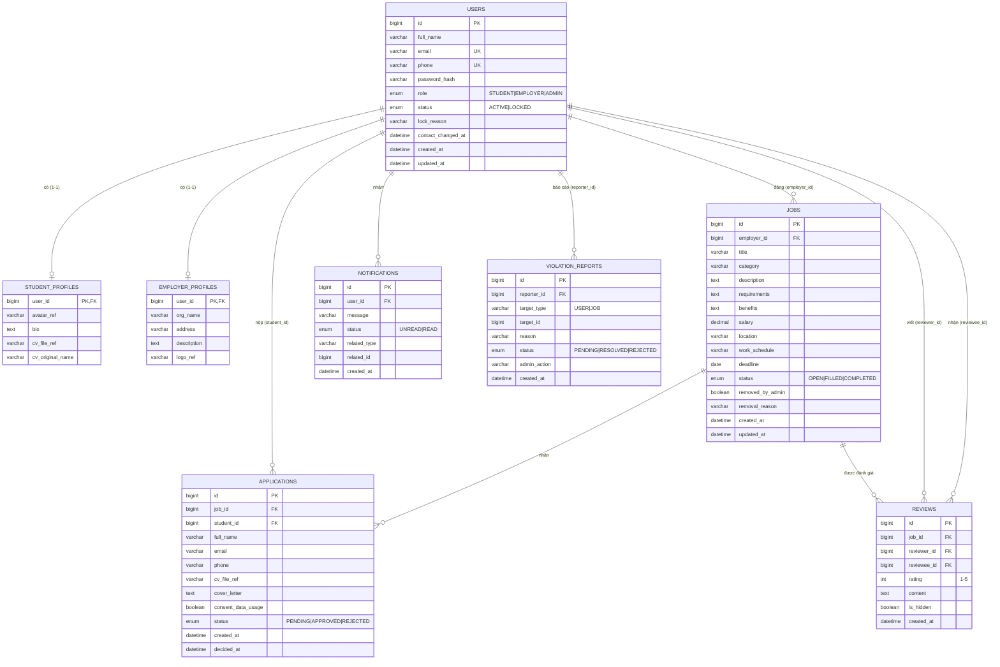

# Thiết kế CSDL (ERD) và API Contract

Dự án: Freelance Marketplace cho sinh viên. Backend Spring Boot, CSDL quan hệ (H2 khi dev, MySQL khi triển khai).
Base URL: `http://localhost:8082/api`

---

## PHẦN 1. ERD (Sơ đồ thực thể - quan hệ)

### 1.1 Sơ đồ

### 1.2 Danh sách bảng, khóa chính, khóa ngoại

| Bảng | Khóa chính (PK) | Khóa ngoại (FK) | Ràng buộc duy nhất / ghi chú |
|---|---|---|---|
| `users` | `id` | không | `email` UNIQUE, `phone` UNIQUE |
| `student_profiles` | `user_id` | `user_id` → `users.id` | Quan hệ 1-1 với users (PK đồng thời là FK) |
| `employer_profiles` | `user_id` | `user_id` → `users.id` | Quan hệ 1-1 với users |
| `jobs` | `id` | `employer_id` → `users.id` | Có index; `removed_by_admin` dùng để xóa mềm |
| `applications` | `id` | `job_id` → `jobs.id`, `student_id` → `users.id` | UNIQUE (`job_id`, `student_id`): mỗi sinh viên chỉ ứng tuyển 1 lần cho 1 việc |
| `reviews` | `id` | `job_id` → `jobs.id`, `reviewer_id` → `users.id`, `reviewee_id` → `users.id` | UNIQUE (`job_id`, `reviewer_id`, `reviewee_id`); `rating` từ 1 đến 5 |
| `notifications` | `id` | `user_id` → `users.id` | `related_type` + `related_id` trỏ đa hình tới APPLICATION, JOB, REVIEW (không phải FK thật) |
| `violation_reports` | `id` | `reporter_id` → `users.id` | `target_type` + `target_id` trỏ đa hình tới USER hoặc JOB (không phải FK thật) |

### 1.3 Quan hệ giữa các bảng

| Quan hệ | Loại | Giải thích |
|---|---|---|
| users – student_profiles | 1 – 1 | Mỗi sinh viên có tối đa 1 hồ sơ |
| users – employer_profiles | 1 – 1 | Mỗi nhà tuyển dụng có tối đa 1 hồ sơ công ty |
| users (EMPLOYER) – jobs | 1 – N | Một nhà tuyển dụng đăng nhiều việc |
| jobs – applications | 1 – N | Một việc có nhiều đơn ứng tuyển |
| users (STUDENT) – applications | 1 – N | Một sinh viên nộp nhiều đơn |
| users – jobs – applications | N – N | Quan hệ nhiều-nhiều giữa sinh viên và việc, được tách qua bảng `applications` |
| jobs – reviews | 1 – N | Một việc có nhiều đánh giá (hai chiều) |
| users – reviews | 1 – N (2 lần) | Một user là người viết (`reviewer`) và là người được đánh giá (`reviewee`) |
| users – notifications | 1 – N | Một user có nhiều thông báo |
| users – violation_reports | 1 – N | Một user có thể gửi nhiều báo cáo vi phạm |

### 1.4 Enum

| Enum | Giá trị |
|---|---|
| `UserRole` | STUDENT, EMPLOYER, ADMIN |
| `UserStatus` | ACTIVE, LOCKED |
| `JobStatus` | OPEN, FILLED, COMPLETED |
| `ApplicationStatus` | PENDING, APPROVED, REJECTED |
| `NotificationStatus` | UNREAD, READ |
| `ViolationStatus` | PENDING, RESOLVED, REJECTED |

---

## PHẦN 2. API CONTRACT

Quy ước chung:
- Định dạng dữ liệu: JSON, header `Content-Type: application/json`.
- Danh sách trả về dạng **Page** của Spring: `{ content: [...], totalElements, totalPages, number, size }`. Hỗ trợ `?page=0&size=20`.
- Mã lỗi: `400` dữ liệu không hợp lệ, `401` sai thông tin đăng nhập, `403` bị khóa hoặc không có quyền, `404` không tìm thấy, `409` trùng dữ liệu (email, SĐT, ứng tuyển lặp).
- Hiện chưa dùng JWT. Các API xác định người gọi bằng tham số `employerId`, `studentId`, `userId`, `reviewerId`.

### 2.1 Auth (`/auth`)

| Method | Endpoint | Tham số / Body | Mô tả | Phản hồi |
|---|---|---|---|---|
| POST | `/auth/register` | Body: `fullName` (3-100), `email`, `phone` (`^0\d{9}$`), `password` (6-50), `role` (STUDENT/EMPLOYER) | Đăng ký tài khoản | 201 `{success, data: user}`; 400, 409 |
| POST | `/auth/login` | Body: `email`, `password` | Đăng nhập | 200 `{success, data: user}`; 401 sai thông tin; 403 tài khoản bị khóa |
| GET | `/auth/health` | không | Kiểm tra dịch vụ | 200 `{success, message, timestamp}` |
| GET | `/auth/admin/stats` | không | Thống kê toàn hệ thống (Admin) | 200 `{success, data: stats}` |
| GET | `/auth/admin/search` | Query tìm kiếm user | Admin tìm kiếm user | 200 danh sách user |

### 2.2 Jobs (`/jobs`)

| Method | Endpoint | Tham số / Body | Mô tả | Phản hồi |
|---|---|---|---|---|
| POST | `/jobs` | Body: `employerId`, `title` (>=5), `description` (>=20), `requirements`, `benefits`, `category`, `location`, `workSchedule`, `salary`, `deadline` (yyyy-MM-dd) | Tạo việc, status mặc định OPEN | 201 JobDTO; 400; 404 employer không tồn tại |
| GET | `/jobs` | Query tùy chọn: `keyword`, `location`, `category`, `page`, `size` | Danh sách việc OPEN, có lọc | 200 Page<JobDTO> |
| GET | `/jobs/search` | Như trên | Tương thích cũ, giống `GET /jobs` có lọc | 200 Page<JobDTO> |
| GET | `/jobs/{id}` | Path: `id` | Chi tiết việc | 200 JobDTO; 404 |
| GET | `/jobs/employer/{employerId}` | Path: `employerId` | Việc của một nhà tuyển dụng | 200 Page<JobDTO> |
| PATCH | `/jobs/{id}?employerId=` | Body: các trường cần sửa | Sửa việc (chỉ chủ việc, chỉ khi OPEN) | 200 JobDTO; 400, 404 |
| PATCH | `/jobs/{id}/status?employerId=` | Body: `status` (OPEN/FILLED/COMPLETED) | Đổi trạng thái việc | 200 JobDTO |

**JobDTO:** `id, title, description, requirements, benefits, category, location, workSchedule, salary, deadline, status, employerId, createdAt, updatedAt`

### 2.3 Applications (`/jobs/{jobId}/applications`)

| Method | Endpoint | Tham số / Body | Mô tả | Phản hồi |
|---|---|---|---|---|
| POST | `/jobs/{jobId}/applications` | Body: `studentId`, `fullName`, `email`, `phone`, `coverLetter`, `cvFileRef`, `consentDataUsage` (bắt buộc true) | Sinh viên ứng tuyển | 201 ApplicationDTO; 409 đã ứng tuyển |
| GET | `/jobs/{jobId}/applications?employerId=` | Query: `employerId` | Nhà tuyển dụng xem ứng viên của việc | 200 danh sách ApplicationDTO |
| PATCH | `/jobs/{jobId}/applications/{applicationId}/approve?employerId=` | không | Duyệt ứng viên | 200 ApplicationDTO (APPROVED) |
| PATCH | `/jobs/{jobId}/applications/{applicationId}/reject?employerId=` | không | Từ chối ứng viên | 200 ApplicationDTO (REJECTED) |

### 2.4 Reviews (`/reviews`)

| Method | Endpoint | Tham số / Body | Mô tả | Phản hồi |
|---|---|---|---|---|
| POST | `/reviews/jobs/{jobId}?reviewerId=&revieweeId=` | Body: `rating` (1-5), `content` | Tạo đánh giá sau khi việc hoàn thành | 201 ReviewDTO; 409 đã đánh giá |
| GET | `/reviews/jobs/{jobId}` | không | Đánh giá của một việc | 200 danh sách |
| GET | `/reviews/users/{userId}` | không | Đánh giá nhận được của một user | 200 danh sách |
| GET | `/reviews/{reviewId}` | không | Chi tiết một đánh giá | 200 ReviewDTO; 404 |

### 2.5 Notifications (`/notifications`)

| Method | Endpoint | Tham số | Mô tả | Phản hồi |
|---|---|---|---|---|
| GET | `/notifications?userId=` | `userId`, phân trang | Danh sách thông báo | 200 Page |
| GET | `/notifications/{notificationId}?userId=` | `userId` | Chi tiết thông báo | 200 |
| PATCH | `/notifications/{notificationId}/read?userId=` | `userId` | Đánh dấu đã đọc | 200 |
| GET | `/notifications/count/unread?userId=` | `userId` | Đếm chưa đọc | 200 số nguyên |

### 2.6 Profiles (`/profiles`)

| Method | Endpoint | Body | Mô tả |
|---|---|---|---|
| GET | `/profiles/students/{studentId}` | không | Xem hồ sơ sinh viên |
| PATCH | `/profiles/students/{studentId}` | `avatarRef, bio, cvFileRef, cvOriginalName` | Cập nhật hồ sơ sinh viên |
| GET | `/profiles/employers/{employerId}` | không | Xem hồ sơ công ty |
| PATCH | `/profiles/employers/{employerId}` | `orgName, address, description, logoRef` | Cập nhật hồ sơ công ty |

### 2.7 Admin (`/admin`)

| Method | Endpoint | Tham số | Mô tả |
|---|---|---|---|
| DELETE | `/admin/jobs/{jobId}?reason=` | `reason` | Gỡ việc vi phạm (xóa mềm, `removed_by_admin = true`) |
| PATCH | `/admin/users/{userId}/lock?reason=` | `reason` | Khóa tài khoản |
| PATCH | `/admin/users/{userId}/unlock` | không | Mở khóa tài khoản |
| GET | `/admin/reports` | phân trang | Danh sách báo cáo vi phạm |
| PATCH | `/admin/reports/{reportId}/resolve?adminAction=` | `adminAction` | Xử lý báo cáo |
| PATCH | `/admin/reports/{reportId}/reject` | không | Từ chối báo cáo |

### 2.8 Luồng nghiệp vụ chính

1. Nhà tuyển dụng đăng ký (EMPLOYER), đăng nhập, `POST /jobs`.
2. Sinh viên đăng ký (STUDENT), `GET /jobs` để xem và lọc, `POST /jobs/{id}/applications` để ứng tuyển.
3. Nhà tuyển dụng `GET /jobs/{id}/applications`, sau đó duyệt (approve) hoặc từ chối (reject). Hệ thống tạo `notifications` cho sinh viên.
4. Khi xong việc, nhà tuyển dụng đổi status sang `COMPLETED`, hai bên `POST /reviews/jobs/{jobId}`.
5. Admin xử lý vi phạm: gỡ việc, khóa user, xử lý `violation_reports`.

### 2.9 Chênh lệch cần sửa giữa frontend và backend

File `freelance-frontend/src/api/apiService.js` đang khai báo một số đường dẫn khác backend, cần sửa để khớp contract này:

| Frontend đang gọi | Backend thật |
|---|---|
| `/profiles/student/{id}`, `/profiles/employer/{id}` | `/profiles/students/{id}`, `/profiles/employers/{id}` |
| `/notifications/unread` | `/notifications/count/unread` |
| `/reviews` (POST), `/reviews/user/{id}` | `/reviews/jobs/{jobId}`, `/reviews/users/{id}` |
| `/admin/violations`, `.../violations/{id}/resolve` | `/admin/reports`, `/admin/reports/{id}/resolve` |
